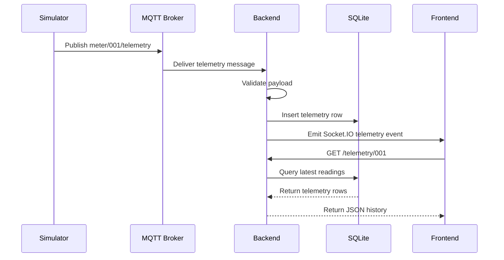

# IoT Platform

A small IoT learning platform that simulates smart meter devices, sends telemetry through MQTT, stores readings in a backend service, and displays live device data in a Vue dashboard.

## Architecture

```text
simulator -> MQTT broker -> backend -> SQLite
                               |
                               v
                         Socket.IO events
                               |
                               v
                         frontend dashboard
```

## Project Structure

```text
backend/     Express, MQTT subscriber, Socket.IO server, SQLite storage
frontend/    Vue 3, TypeScript, Vite, ECharts dashboard
simulator/   MQTT publisher that simulates smart meter telemetry
```

## Prerequisites

- Node.js and npm
- Mosquitto or another MQTT broker running on `localhost:1883`

If you are using Mosquitto, start it before running the app. One common command is:

```bash
mosquitto -v
```

## Install Dependencies

Run this once in each app folder:

```bash
cd backend
npm install

cd ../simulator
npm install

cd ../frontend
npm install
```

## Start The Project

Open three terminals after the MQTT broker is running.

### 1. Start The Backend

```bash
cd backend
npm start
```

The backend runs at:

```text
http://localhost:3000
```

### 2. Start The Simulator

```bash
cd simulator
npm start
```

The simulator publishes telemetry every 2 seconds to MQTT topics like:

```text
meter/001/telemetry
meter/002/telemetry
meter/003/telemetry
```

While the simulator is running, you can type commands into its terminal:

```text
status
offline 002
online 002
random off
random on
help
```

Use `random off` when you want to manually test one device at a time without the simulator changing device status automatically.

### 3. Start The Frontend

```bash
cd frontend
npm run dev
```

The dashboard usually runs at:

```text
http://localhost:5173
```

## Useful Endpoints

Backend health check:

```text
GET http://localhost:3000/
```

Latest telemetry for a device:

```text
GET http://localhost:3000/telemetry/001
```

## Expected Data Flow

1. The simulator creates telemetry for devices `001`, `002`, and `003`.
2. It publishes each reading to the local MQTT broker.
3. The backend subscribes to `meter/+/telemetry`.
4. The backend validates each message, stores it in SQLite, and emits it through Socket.IO.
5. The frontend receives live telemetry and updates the dashboard.

## Telemetry Sequence



## Troubleshooting

If the backend does not receive telemetry:

- Confirm the MQTT broker is running on `localhost:1883`.
- Start the backend before the simulator.
- Check that the simulator logs show published messages.

If the frontend does not update:

- Confirm the backend is running on `http://localhost:3000`.
- Confirm the frontend is running on `http://localhost:5173`.
- Check the browser console for Socket.IO connection errors.

If telemetry history is empty:

- Let the simulator run for a few seconds.
- Confirm the backend has created `backend/data/telemetry.db`.
- Request `http://localhost:3000/telemetry/001` after messages have been received.

## Learning Plan

See [IOT_ENGINEER_LEARNING_PLAN.md](./IOT_ENGINEER_LEARNING_PLAN.md) for the step-by-step path from frontend developer to IoT engineer using this project.
